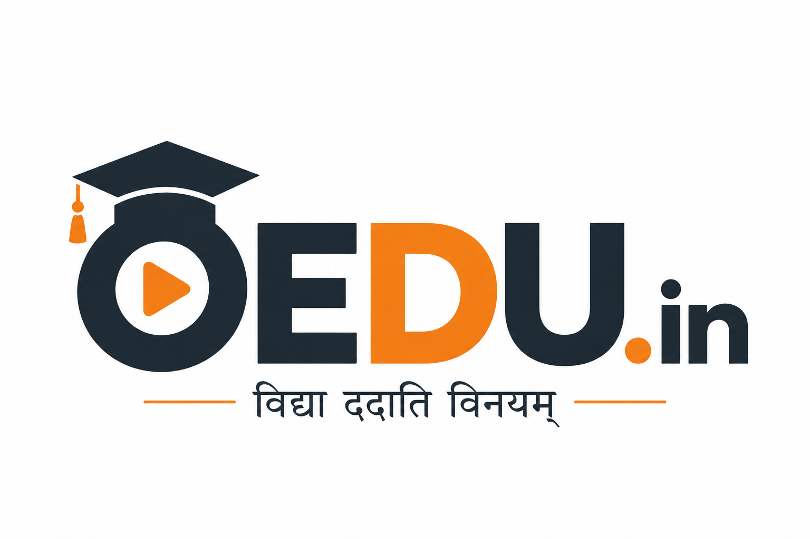

# Online Education — National Education Platform of India

<p align="center">
  
</p>

<p align="center">
  
  
  
  
  
</p>

> **विद्या ददाति विनयम्** — One Education Platform for Every Citizen  
> 🌐 **Live Portal:** [oedu.in](https://oedu.in)  
> 📘 **Official Facebook Page:** [facebook.com/oeduin](https://www.facebook.com/oeduin)

Comprehensive national directory of **106,000+** educational institutions across all **36 States & UTs** and **780 Districts** of India, powered by official AISHE, BCI, and CBSE registries.

---

## 🏛️ Directory & Platform Coverage

- **1,505+ Universities** — Central, State Public, State Private, Deemed, and Institutes of National Importance (IITs, IIMs, AIIMS, NITs).
- **54,351+ Affiliated Colleges** — Government, Private Aided, and Private Un-aided colleges linked to their parent affiliating universities.
- **17,010+ Standalone Institutes** — Polytechnics, Nursing colleges, Teacher Training institutes, Paramedical institutions, and PGDM business schools.
- **33,180+ CBSE Schools** — Comprehensive national directory of Central Board of Secondary Education schools searchable by affiliation number, school code, state, and district.
- **3,100+ BCI Approved Law Colleges** — National registry of Bar Council of India approved legal education centres offering 3-Year LLB and 5-Year Integrated Law courses.
- **Curriculum & Syllabus** — Official CBSE Class 9 to 12 syllabi, marking schemes, and subject blueprints.
- **National Entrance Examinations** — Cutoffs, counseling schedules, and dates for CUET-UG/PG, JEE Main, NEET-UG, GATE, and CAT.
- **Admissions Lead Gateway** — Real-time student admission inquiry routing with DLT-compliant SMS notifications.

---

## 🛠️ Tech Stack & Architecture

- **Backend:** PHP 8.3 with PDO MySQL (`utf8mb4`).
- **Frontend:** Semantic HTML5, CSS3 Custom Design System (responsive desktop & mobile drawer), and Vanilla JavaScript.
- **Database:** MySQL 8.x with compound indices for sub-second searches across 100,000+ records.
- **SEO & Webmaster Suite:**
  - Automated XML Sitemap engine (`sitemap.php`) generating sectioned sitemaps for universities, colleges, standalone institutes, CBSE schools, and law colleges.
  - JSON-LD Structured Data for `WebSite`, `Organization`, and educational institution entities.
  - Google Search Console & Bing Webmaster verification support.
- **Brand Assets:** Multi-resolution `favicon.ico` (16×16, 32×32, 48×48), SVG vector favicon, and Apple Touch Icon suite.

---

## ⚙️ Admin Control Hub & Git Version Control

The administration panel (`/admin/`) includes built-in Version Control & System Management:

* **1-Click System Updates:** Pull the latest production updates from `origin/main` directly through the browser with automated pre-update stashing to prevent merge collisions.
* **Release Versioning & Tagging:** Track semantic versions (e.g., `v1.0.0`), create new release tags, and push tags directly to GitHub.
* **Interactive Diff Inspector:** View line-by-line syntax-highlighted git diffs before committing or deploying changes.
* **Branch Management:** Switch between active branches or create feature branches.
* **Commit History & Soft Undo:** Inspect recent commits with direct links to GitHub commits and perform soft rollbacks if needed.
* **Personal Access Token (PAT) Integration:** Encrypted token storage for seamless, non-interactive remote authentication.

---

## 🚀 Setup & Local Installation

1. **Clone the repository:**
   ```bash
   git clone https://github.com/kgauravindia/oedu.git
   cd oedu
   ```

2. **Configure Database:**
   Copy the example database config:
   ```bash
   cp includes/db.php.example includes/db.php
   ```
   Update `includes/db.php` with your local MySQL credentials (`DB_HOST`, `DB_NAME`, `DB_USER`, `DB_PASS`).

3. **Serve Locally:**
   Run via Laragon or PHP built-in server:
   ```bash
   php -S localhost:8000
   ```

---

## 📁 Project Structure

```
├── .htaccess                 # Apache rewrite rules, security guards & GZIP compression
├── api.php                   # Unified RESTful JSON API (Search, Directories, Leads, Stats)
├── api/                      # API forwarders and district endpoints
├── assets/
│   ├── css/style.css         # Custom responsive design system
│   ├── js/main.js            # Vanilla JS (cascading dropdowns, mobile navigation)
│   ├── favicon.svg           # Scalable vector brand favicon
│   ├── favicon-48x48.png     # Google Search mobile snippet icon
│   └── apple-touch-icon.png  # Apple iOS home screen icon
├── admin/                    # Admin Control Hub
│   ├── git.php               # Git Version Control & 1-Click Update Console
│   ├── git-helper.php        # Windows/Linux Git CLI integration service
│   ├── settings.php          # Portal parameters & quick system update card
│   ├── sitemap.php           # XML Sitemap batch builder
│   ├── universities.php      # University registry management
│   ├── colleges.php          # Affiliated college directory
│   ├── law-colleges.php      # BCI Law colleges management
│   ├── institutes.php        # Standalone institutes directory
│   └── enquiries.php         # Student admission counseling leads
├── database/                 # Protected database dumps and schema migrations
│   ├── .htaccess             # Deny all direct web access
│   └── law_college.sql       # BCI Law College reference schema
├── includes/
│   ├── db.php                # Active PDO database connection
│   ├── header.php            # Global navigation ribbon, favicons & Schema.org JSON-LD
│   ├── footer.php            # Footer links & national accreditation badges
│   ├── seo.php               # Centralized canonical URLs & SEO metadata
│   └── sms.php               # DLT SMS OTP service
├── school/                   # National CBSE Schools Directory
│   ├── index.php             # Searchable directory with state/district filters
│   └── school-detail.php     # Detailed school profile (affiliation, board, contacts)
├── index.php                 # Homepage with live directory counters & 3-step finder
├── college.php               # 54k+ Affiliated colleges directory
├── college-detail.php        # College profile & university linkage
├── university-detail.php     # University profile & affiliated list
├── law-college.php           # 3.1k+ BCI Law Colleges directory
├── law-college-detail.php    # Law college profile & approved courses
├── institute.php             # 17k+ Standalone institutes directory
├── syllabus.php              # CBSE Curriculum & Syllabus explorer
├── search.php                # Unified Omnibox search across all directories
├── favicon.ico               # Multi-resolution ICO (16×16, 32×32, 48×48)
├── robots.txt                # Search engine crawler instructions & sitemap link
└── sitemap.xml               # Master XML Sitemap index
```

---

## 🔒 Security & Privacy

* Database credentials (`includes/db.php`), logs, and sensitive dumps are strictly excluded from version control or placed in access-denied directories.
* All admin endpoints require authenticated session verification via `auth_check.php`.
* Inputs across public search and filters are sanitized with prepared PDO statements to prevent SQL injection.
